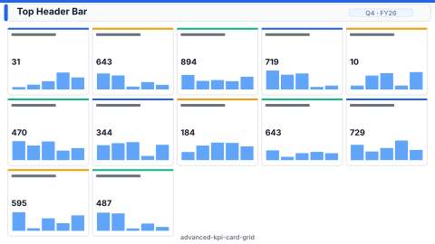

# Layout: Advanced KPI Card Grid

> **Preview:** [](../../assets/layout-previews/advanced-kpi-card-grid.svg) · variants: [annotated](../../assets/layout-previews/advanced-kpi-card-grid-annotated.svg) · [dark](../../assets/layout-previews/advanced-kpi-card-grid-dark.svg)

- **id:** `advanced-kpi-card-grid`
- **Canvas:** 1920 × 1080
- **Style personality:** Executive — 4×5 grid of Advanced Card visuals — each embeds a sparkline + comparison arrow + Δ%
- **Audience:** Execs who want *every* KPI on one screen with its micro-trend
- **Visual count:** 20
- **Pairs with themes:** neutral body with one accent — pattern designed to read on any corporate palette.
- **Observed in:** `references-pbip/FIS DEMO (EC).Report/` — '6. %GROWTH' (33 advanceCard visuals)

---

## Zone map

```
┌────────────────────────────────────────────────────────────────┐ 0
│ Header: title + period + comparison-period toggle              │ 80
├──────────────┬──────────────┬──────────────┬──────────────┬────┤
│ Card  ~^-^  │ Card  ~^-^  │ Card  ~^-^  │ Card  ~^-^  │    │
│  KPI  +5%   │  KPI  -2%   │  KPI  +11%  │  KPI  +3%   │    │ 220
├──────────────┼──────────────┼──────────────┼──────────────┤    │
│ (row 2)     │              │              │              │     │ 220
├──────────────┼──────────────┼──────────────┼──────────────┤    │
│ (row 3)     │              │              │              │     │ 220
├──────────────┼──────────────┼──────────────┼──────────────┤    │
│ (row 4)     │              │              │              │     │ 220
└──────────────┴──────────────┴──────────────┴──────────────┴────┘
```

---

## Slot specifications

| Slot | x | y | w | h | Visual type | Notes |
|---|---|---|---|---|---|---|
| Header | 0 | 0 | 1920 | 80 | shape + textbox + slicer(Period) + slicer(Compare-to) | Title + period + comparison toggle |
| Card grid (4 rows × 5 cols) | 32 | 104 | 1856 | 952 | customVisual(advanceCard) × 20 | Each card 352w × 220h with 24px gutters (5 × 352 + 4 × 24 = 1856; 4 × 220 + 3 × 24 = 952); embeds metric, delta, sparkline, arrow |

Gutters: one 24px tier everywhere — between header and grid, between card columns, and between card rows.

---

## Navigation

- Reachable from the report's top-nav chiclet strip or landing page. Include a small 'Home' actionButton in the header when not the landing page.
- Cross-links out to related drillthrough / detail pages should be surfaced via card-level actions, not a separate nav rail.

---

## Theme + iconography guidance

- **Palette:** Neutral cards; delta arrow green/red; sparkline uses one accent.
- **Logo:** Header top-left at (32, 28) max height 24px.
- **Icons:** Tiny glyph per card (optional) representing the KPI category (FX, volume, margin, etc.).
- **Fonts:** Card value 14pt, delta 9pt, sparkline axis hidden.

---

## When NOT to use this layout

- ❌ Tenant blocks custom visuals — fall back to `scorecard-kpi-grid` (native cards)
- ❌ < 8 KPIs — a single row of native cards is enough
- ❌ Audience wants to *analyse* a KPI — provide a link-out to `sales-performance` or similar

---

## Customization allowed

- Change grid to 3 rows × 6 cols (18 cards) if KPI count fits
- Group cards with thin dividers labelled by category
- FHD headroom (optional): none — at budget (the 20-card grid already exceeds the Executive budget of 6 visuals; the freed FHD space goes into larger cards, not extra slots)

## Customization NOT allowed

- Mixing AdvancedCard with native card visuals in the same grid (inconsistent sparkline behaviour)
- Animated sparklines (distracts, performance drag)
