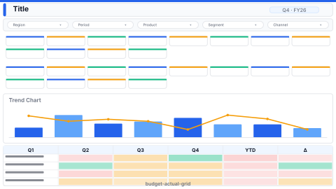

# Layout: Budget vs Actual Grid

> **Preview:** [](../../assets/layout-previews/budget-actual-grid.svg) · variants: [annotated](../../assets/layout-previews/budget-actual-grid-annotated.svg) · [dark](../../assets/layout-previews/budget-actual-grid-dark.svg)

- **id:** `budget-actual-grid`
- **Canvas:** 1920 × 1080
- **Style personality:** Analytical — budget workbench
- **Audience:** FP&A analysts, budget owners, line managers during re-forecast
- **Visual count:** 10 (4 actual / estimate card pairs + 1 pivot matrix + 1 trend + 1 slicer + 1 title) — reflow-enhanced (was 8)
- **Pairs with themes:** neutral; 1 accent for "estimate" vs solid base for "actual"
- **Observed in:** `references-pbip/AEON_BGT_Data Analysis_Demo.Report/` — "Overview"

---

## Zone map

```
┌────────────────────────────────────────────────────────────────┐ 0
│ Title + slicer: Period                                        │ 72
├─────────────────────────────────────┬──────────────────────────┤
│                                     │                          │
│ Actual / estimate card pairs        │                          │
│ ┌──────────┐ ┌──────────┐           │                          │
│ │ Act1     │ │ Est1     │           │                          │
│ └──────────┘ └──────────┘           │                          │
│ ┌──────────┐ ┌──────────┐           │  Pivot matrix            │ 528
│ │ Act2     │ │ Est2     │           │  (Product × Period)     │
│ └──────────┘ └──────────┘           │                          │
│ ┌──────────┐ ┌──────────┐           │                          │
│ │ Act3     │ │ Est3     │           │                          │
│ └──────────┘ └──────────┘           │                          │
│ ┌──────────┐ ┌──────────┐           │                          │
│ │ Act4     │ │ Est4     │           │                          │
│ └──────────┘ └──────────┘           │                          │
├─────────────────────────────────────┤                          │
│  Trend chart (actual vs estimate)   │                          │ 400
└─────────────────────────────────────┴──────────────────────────┘ 1080
```

---

## Slot specifications

| Slot | x | y | w | h | Visual type | Notes |
|---|---|---|---|---|---|---|
| Title | 32 | 24 | 1056 | 48 | textbox | "Budget vs Actual — {Period}" |
| Slicer: Period | 1408 | 24 | 480 | 48 | slicer (buttons) | MTD / QTD / YTD |
| Actual card 1–4 | 32 | 96 / 232 / 368 / 504 | 328 | 120 | card | Left column, solid accent left-border |
| Estimate card 1–4 | 376 | 96 / 232 / 368 / 504 | 328 | 120 | card | Right column, muted / hatched left-border |
| Trend chart | 32 | 648 | 680 | 400 | lineChart | Actual line solid, estimate line dashed |
| Pivot matrix | 736 | 96 | 1152 | 952 | pivotTable | Rows=product / BU, cols=period, values=actual + estimate |

Pair spacing: 16px between Actual/Estimate card in each row and 16px vertical between rows (one intra-group tier); 24px between the card column, trend chart and matrix (inter-group tier). The pair alignment is itself the read signal — left-column is always actual, right-column always estimate.

---

## Navigation

Single-page workbench. Optional "Scenario" bookmarks row above title bar (push title and slicer to y=64, start the content at y=136, and trim Trend chart and Pivot matrix `h` by 40).

---

## Theme + iconography guidance

- **Palette:** one solid accent for "Actual", the same accent at 40% opacity / hatched for "Estimate". NO other hues.
- **Logo:** omit on this workbench page — the audience is internal analysts. If branding is mandated, put it in the title bar at `(32, 36)` max height 24px and shift title to x=80 (`w=1008`).
- **Icons:** none in cards. Small legend chip near trend chart: ■ Actual · ▨ Estimate.
- **Fonts:** card value 24pt Semibold, label 11pt muted. Matrix headers 11pt bold, cells 11pt.

---

## When NOT to use this layout

- ❌ No estimate / forecast data available — collapses to a single-column actuals page (use `exec-overview-16x9` instead)
- ❌ > 6 metrics needing pairs — grid over-runs the vertical space
- ❌ Mobile / tooltip — matrix is unreadable at small canvases

---

## Customization allowed

- Add a third column "Variance %" card between Actual and Estimate (widths: 216 / 216 / 216 with 16px gutter)
- Collapse trend chart if screen real estate is limited (extend matrix down into the bottom band)
- Swap matrix for a ranked-bar (top contributors to variance)
- FHD headroom (optional): none — at budget (8 cards + trend + matrix = 10 data visuals, 12 with the v0.6 reflow, the Analytical maximum)

## Customization NOT allowed

- Reversing column order (estimate-left / actual-right — breaks the "what is" before "what was planned" reading)
- Using different accents for each pair (the eye needs a single actual-vs-estimate colour pattern)

---

## Reflow additions (v0.6)

The matrix dominates the right half but offers no interpretive layer. Reclaim a **56h commentary strip** above it for narrative callouts, and a **right-edge %-attainment heatmap column** that converts the matrix's raw numbers into a scan-friendly traffic-light encoding per row.

### Integration

Shrink **Pivot matrix** `h` from `952` to `880` (matrix starts at `y=168` instead of `y=96`; 56h commentary slot goes above with a 16px gap). Narrow matrix `w` from `1152` to `952` to create a 184w heatmap column at `x=1704`.

### New slots

| Slot | x | y | w | h | Visual type | Notes |
|---|---|---|---|---|---|---|
| Budget commentary strip | 736 | 96 | 1152 | 56 | textbox + shape | Key driver commentary; refreshes monthly; 12pt |
| %-attainment heatmap | 1704 | 168 | 184 | 880 | pivotTable (% formatting) | Rows mirror pivot; single-column heat: red<90, amber 90–100, green>100 |

