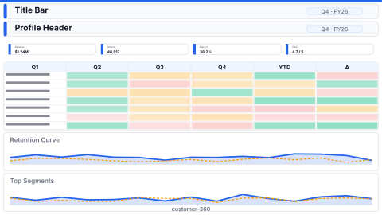

# Layout: Customer 360

> **Preview:** [](../../assets/layout-previews/customer-360.svg) · variants: [annotated](../../assets/layout-previews/customer-360-annotated.svg) · [dark](../../assets/layout-previews/customer-360-dark.svg)

- **id:** `customer-360`
- **Canvas:** 1920 × 1080
- **Style personality:** Analytical — dense, diagnostic, comparison-ready
- **Audience:** Account managers, CX analysts, retention teams
- **Visual count:** 9
- **Pairs with themes:** neutral analytical themes; semantic status colors (good/warn/bad)

## Zone map

```
┌────────────────────────────────────────────────────────────────┐ 0
│ Title bar: "Customer 360 — {CustomerName}"                    │ 64
├────────────────────────────────────────────────────────────────┤
│ Profile header (avatar / logo, tier chip, tenure, owner)      │ 112
├────────────────────────────────────────────────────────────────┤
│ ┌──KPI1──┐ ┌──KPI2──┐ ┌──KPI3──┐ ┌──KPI4──┐                   │ 136
│ │ LTV    │ │ NPS    │ │ Churn% │ │ Open $ │                   │
│ └────────┘ └────────┘ └────────┘ └────────┘                   │
├────────────────────────────────────────────────────────────────┤
│ Cohort retention matrix       │ Retention curve               │ 368
│ (months-since-signup × month) │ (overlay: cohort vs all)      │
├────────────────────────────────────────────────────────────────┤
│ Top segments / product mix / recent activity (grid of 3)      │ 280
└────────────────────────────────────────────────────────────────┘ 1080
```

## Slot specifications

| Slot | x | y | w | h | Visual type | Notes |
|---|---|---|---|---|---|---|
| Title bar | 24 | 16 | 1872 | 64 | textbox | 24pt Semibold |
| Profile header | 24 | 96 | 1296 | 112 | card/shape | Avatar 64px + company + tier chip + owner; the right 560 px of this row (x=1336..1896) is left free for the optional FHD headroom cards — widen to w=1872 if unused |
| KPI 1 | 24 | 224 | 456 | 136 | card | LTV |
| KPI 2 | 496 | 224 | 456 | 136 | card | NPS |
| KPI 3 | 968 | 224 | 456 | 136 | card | Churn% |
| KPI 4 | 1440 | 224 | 456 | 136 | card | Open Pipeline |
| Cohort matrix | 24 | 384 | 928 | 368 | pivotTable | Color-scale background by retention % |
| Retention curve | 968 | 384 | 928 | 368 | line | Cohort vs. all-customers overlay |
| Segment 1 | 24 | 776 | 608 | 280 | bar / donut | Product mix |
| Segment 2 | 648 | 776 | 624 | 280 | bar | Top categories |
| Segment 3 | 1288 | 776 | 608 | 280 | tableEx | Recent activity |

Gutters: 24px edge margin; 16px between slots in a group; 24px between groups (header / KPIs / analysis / segments).

## Navigation

Typically the **drillthrough target** from a customer hub page. Include Back button at (24, 24, 48, 32) (inside the title bar) if drillthrough.

## Theme + iconography guidance

- **Palette:** neutral + 1 semantic triad (good/warn/bad)
- **Logo:** **two logos** on this layout. (1) Corporate wordmark top-left of title bar, 24px (small — not the focus). (2) Customer avatar / logo inside the profile-header block at `(40, 128)`, 48px circle — this is the identity anchor for the page.
- **Icons:** tier badge (crown / star / bronze), trend up/down on KPIs
- **Cohort color:** sequential single-hue scale; legend on retention curve

## When NOT to use this layout

- ❌ Account list / search — use a sortable table page
- ❌ Product-centric analysis (flip to `sales-performance` or a product-360 variant)
- ❌ You don't have cohort-capable data — drop cohort matrix, use plain trend

## Customization allowed

- Swap the three bottom segment visuals for other customer-level breakdowns (keep the 3-column grid)
- FHD headroom (optional): up to two extra cards in the free right part of the profile row (no overlap with existing slots; 11 data visuals, under the Analytical budget of 12) — **Days since last order** at `x=1336, y=96, w=272, h=112` (card: is the customer going quiet?) and **Open support tickets** at `x=1624, y=96, w=272, h=112` (card: is there service friction?)
