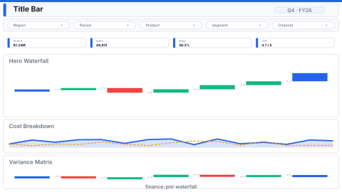

# Layout: Finance P&L Waterfall

> **Preview:** [](../../assets/layout-previews/finance-pnl-waterfall.svg) · variants: [annotated](../../assets/layout-previews/finance-pnl-waterfall-annotated.svg) · [dark](../../assets/layout-previews/finance-pnl-waterfall-dark.svg)

- **id:** `finance-pnl-waterfall`
- **Canvas:** 1920 × 1080
- **Style personality:** Analytical (see `../executor-analytical.md`)
- **Audience:** CFO, controllers, FP&A analysts
- **Visual count:** 6 (hero waterfall + supporting)

---

## Zone map

```
┌────────────────────────────────────────────────────────────────┐ 0
│  Big-Idea P&L title (24pt)                 [Period slicer]    │ 88
├────────────────────────────────────────────────────────────────┤
│  ┌──────────┐┌──────────┐┌──────────┐┌──────────┐              │
│  │ Revenue  ││  COGS    ││Gross Marg││Net Income│              │ 128
│  │ + delta  ││ + delta  ││ + delta  ││ + delta  │              │
│  └──────────┘└──────────┘└──────────┘└──────────┘              │
├────────────────────────────────────────────────────────────────┤ 264
│                                                                │
│    ██ ↑ +Rev                                                   │
│    ██                ↓ -COGS                                   │
│  ██──────────────────██ =Gross     ↓ -OpEx                     │ 480
│                         ────────────██                         │
│                                     ────────────── = Net       │
│        HERO: P&L WATERFALL (actual or vs plan)                │
├────────────────────────────────────────────────────────────────┤ 768
│  ┌─────────────────────┐  ┌─────────────────────┐             │
│  │ Cost breakdown bar  │  │ Variance matrix     │             │ 288
│  │ (top N categories)  │  │ (line × plan/act)   │             │
│  └─────────────────────┘  └─────────────────────┘             │
└────────────────────────────────────────────────────────────────┘ 1080
```

---

## Slot specifications

| Slot | x | y | w | h | Visual type | Notes |
|---|---|---|---|---|---|---|
| Page title | 32 | 24 | 1400 | 64 | textbox | Big-Idea framing |
| Period slicer | 1448 | 24 | 440 | 64 | slicer | Horizontal dropdown |
| KPI 1 | 32 | 112 | 456 | 128 | card | Revenue + YoY% |
| KPI 2 | 504 | 112 | 448 | 128 | card | COGS + YoY% |
| KPI 3 | 968 | 112 | 448 | 128 | card | Gross Margin + YoY% |
| KPI 4 | 1432 | 112 | 456 | 128 | card | Net Income + YoY% |
| Hero waterfall | 32 | 264 | 1856 | 480 | waterfallChart | `chart-templates/waterfall-bridge.md` |
| Cost breakdown | 32 | 768 | 920 | 288 | clusteredBarChart | `bar-comparison.md`, top-N opex categories |
| Variance matrix | 968 | 768 | 920 | 288 | pivotTable | `matrix-scorecard.md`, lines × plan / actual / var% |

Gutters: 16px inside a row (title ↔ slicer, KPIs, supporting pair), 24px between rows. Margins 32px (24px top and bottom).

---

## Navigation

- Drillthrough entry point: right-click a waterfall segment → "See details" page
- Period slicer cross-filters all 6 visuals (matrix + breakdown + waterfall + KPIs)

---

## Theme + iconography guidance

- **Palette:** conservative financial — blue `data0` for positive, red `bad` for negative, `neutral` gray for totals
- **Logo:** company wordmark top-left of title bar at `(32, 24)`, max height 28px. Legal entity name + reporting currency ISO-4217 code go immediately right of the logo (audit context).
- **Icons:** minimal; threshold dots on KPI deltas only
- **Fonts:** Segoe UI, 24pt titles, 14pt labels, ALL currency right-aligned with `$#,0;$(#,0)` format
- **Format strings:** use thousands/millions abbreviation for hero axis; full precision in matrix

---

## When NOT to use this layout

- ❌ Revenue-only story (use `sales-performance` layout)
- ❌ > 10 waterfall categories (split into Revenue Walk + Cost Walk pages)
- ❌ Executive who can't absorb a waterfall (swap hero for a 2-bar Plan vs Actual)

---

## Customization allowed

- **FHD headroom (optional)** — one extra slot carved from the hero (visual count 6 → 7, within the Analytical ≤ 12 budget): *Margin % trend* line at (1272, 264, 616, 480); shrink Hero waterfall to w=1224. Answers "is the margin rate improving or eroding over time?" — a rate-over-time question the period-bridge waterfall cannot show.

---

## Data quality gotchas

- **Sign convention:** expenses must be negative in the waterfall source (or explicitly flagged as `isSubtotal`/`isNegative`)
- **Subtotal bars:** mark Gross Margin and Net Income as subtotals in the chart data role, not as additional deltas
- **Variance denominator:** `(Actual - Plan) / ABS(Plan)` — the ABS prevents sign flips on negative plan
- **Missing categories:** if a line has no activity this period, render as $0 with `neutral` color, not omitted
