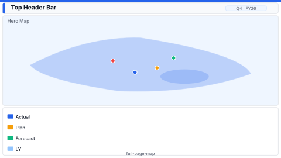

# Layout: Full-Page Map

> **Preview:** [](../../assets/layout-previews/full-page-map.svg) · variants: [annotated](../../assets/layout-previews/full-page-map-annotated.svg) · [dark](../../assets/layout-previews/full-page-map-dark.svg)

- **id:** `full-page-map`
- **Canvas:** 1920 × 1080
- **Style personality:** Analytical — One dominant ArcGIS / Esri map occupying ~65% of the canvas + thin slicer strip
- **Audience:** Field sales / territory managers — geography is the primary analysis axis
- **Visual count:** 4
- **Pairs with themes:** neutral body with one accent — pattern designed to read on any corporate palette.
- **Observed in:** `references-pbip/Sales Analysis (CP Demo).Report/` — 'Map' (ArcGIS visual at x≈252, y≈120, w≈1018, h≈590 on that report's own smaller canvas; not scaled)

---

## Zone map

```
┌────────────────────────────────────────────────────────────────┐ 0
│ Thin header: title + period + region slicer                   │ 64
├────────────────────────┬───────────────────────────────────────┤
│                        │                                       │
│  Compact slicer rail    │                                      │
│   · Region              │                                      │
│   · Channel             │       FULL-CANVAS MAP                │ 856
│   · Metric              │                                      │
│                        │                                       │
│                        │                                       │
├────────────────────────┴───────────────────────────────────────┤
│ Footer: legend · scale · data-last-refresh                     │ 64
└────────────────────────────────────────────────────────────────┘
```

---

## Slot specifications

| Slot | x | y | w | h | Visual type | Notes |
|---|---|---|---|---|---|---|
| Header | 32 | 24 | 1856 | 64 | shape + textbox + slicer(Period) | Title left, period right |
| Slicer rail | 32 | 112 | 320 | 856 | slicer(Region) + slicer(Channel) + slicer(Metric) | Narrow left column |
| Map | 368 | 112 | 1520 | 856 | arcGIS / azureMap / shapeMap | Dominant visual |
| Footer / legend | 32 | 992 | 1856 | 64 | textbox + shape | Metric legend + scale + refresh stamp |

Gutters: 16px between rail and map; 24px between the header, body and footer bands. Margins 32px (24px top and bottom). Map ≈ 63% of the canvas.

---

## Navigation

- Reachable from the report's top-nav chiclet strip or landing page. Include a small 'Home' actionButton in the header when not the landing page.
- Cross-links out to related drillthrough / detail pages should be surfaced via card-level actions, not a separate nav rail.

---

## Theme + iconography guidance

- **Palette:** Map base neutral; data symbology = sequential (magnitude) or diverging (variance). Avoid decorative colours — let symbology carry meaning.
- **Logo:** Header top-left at (40, 32) (inset 8px inside the header slot) max height 28px.
- **Icons:** Small marker glyph in the slicer rail next to 'Metric'.
- **Fonts:** Header 16pt, slicer labels 10pt, legend 9pt.

---

## When NOT to use this layout

- ❌ Territory count < 20 — a column chart by region communicates better
- ❌ Data is global but audience cares about 3 countries only — use `scorecard-kpi-grid` with region cards
- ❌ Tenant blocks ArcGIS Plus / Esri — fall back to `geo-territory-map`

---

## Customization allowed

- Add ONE small overlay card (value of selected region) pinned top-right of the map, e.g. at (1560, 136, 304, 96) — overlay on the Map slot, keeps the map at full size
- Replace the slicer rail with a collapsible outspace pane → map expands to x=32 (w=1856)
- **FHD headroom (optional)**: none — the map is the only analytical visual by design; extra slots would shrink it below 60% (see "NOT allowed").

## Customization NOT allowed

- Adding other charts beside the map (shrinks map below 60% — defeats the pattern; use `sales-performance` instead)
- Embedding multiple maps — pick ONE geography visual per page
