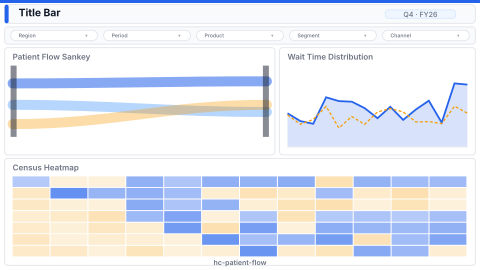

# Patient Flow

> **Preview:**  · variants: [annotated](../../assets/layout-previews/hc-patient-flow-annotated.svg) · [dark](../../assets/layout-previews/hc-patient-flow-dark.svg)

- Canvas: `1920×1080` (landscape-16x9)
- Style: `operational` · Domain: `healthcare`
- Visuals: 7
- Zones: `title-bar, slicer-row, patient-flow-sankey, wait-time-distribution, census-heatmap`

## Use when
Live / daily patient flow review — ED to admit to discharge Sankey with wait times and census

## Avoid when
Outpatient-only settings where flow is linear

## Recommended themes
`healthcare-pharma`, `high-contrast-dark`, `accessible-okabe-ito`

## Chart patterns
`sankey`, `histogram`, `matrix-heat`

## Data requirements
- min_rows: 200
- required_measures: `patient_count`, `wait_time`
- required_dimensions: `unit`, `stage`
- date_grain: `day`

## Customization allowed
- **FHD headroom (optional)** — one extra slot carved from the `census-heatmap` zone (`zones_detail` box x=16, y=632, w=1888, h=432; visual count 7 → 8, within the Operational ≤ 14 budget): *Delay-reason Pareto* bar at (1296, 632, 608, 432); shrink `census-heatmap` to w=1264. Answers "which causes (bed availability, transport, discharge paperwork) explain the longest waits?" — the Sankey shows where patients flow, the histogram how long, neither why.

See `layouts-index.json` for full machine-readable entry including `zones_detail[]`.
