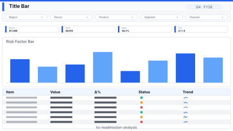

# Readmission Analysis

> **Preview:**  · variants: [annotated](../../assets/layout-previews/hc-readmission-analysis-annotated.svg) · [dark](../../assets/layout-previews/hc-readmission-analysis-dark.svg)

- Canvas: `1920×1080` (landscape-16x9)
- Style: `analytical` · Domain: `healthcare`
- Visuals: 7
- Zones: `title-bar, slicer-row, readmission-rate-kpis, risk-factor-bar, cohort-compare-line`

## Use when
30/60/90-day readmission rates with risk factors and cohort comparison

## Avoid when
Small-volume specialties (n < 50 discharges/month)

## Recommended themes
`healthcare-pharma`, `accessible-okabe-ito`, `public-sector-gov`

## Chart patterns
`kpi-card-with-spark`, `ranking-bar`, `cohort-line`

## Data requirements
- min_rows: 500
- required_measures: `readmit_rate`
- required_dimensions: `diagnosis`, `cohort`
- date_grain: `month`

## Customization allowed
- **FHD headroom (optional)** — coordinates in `layouts-index.json` zone space; each host zone shrinks to make room, so nothing overlaps (7 → 9 visuals, within the Analytical budget of 12):
  - Shrink `risk-factor-bar` to `(16, 304, 1264, 408)`; add `days-to-readmit-histogram` at `(1304, 304, 600, 408)` — how soon after discharge do patients return (early vs late readmits)?
  - Shrink `cohort-compare-line` to `(16, 728, 1264, 336)`; add `unplanned-vs-planned-share` at `(1304, 728, 600, 336)` — what share of readmissions is potentially avoidable?

See `layouts-index.json` for full machine-readable entry including `zones_detail[]`.
