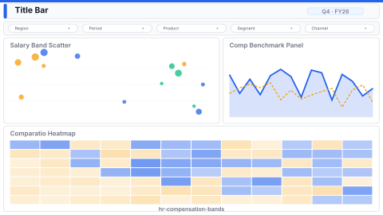

# Compensation Bands & Comparatio

> **Preview:**  · variants: [annotated](../../assets/layout-previews/hr-compensation-bands-annotated.svg) · [dark](../../assets/layout-previews/hr-compensation-bands-dark.svg)

- Canvas: `1920×1080` (landscape-16x9)
- Style: `analytical` · Domain: `hr`
- Visuals: 6
- Zones: `title-bar, slicer-row, salary-band-scatter, comp-benchmark-panel, comparatio-heatmap`

## Use when
Comp review cycle — salary-band scatter vs market median with comparatio distribution

## Avoid when
When market-data benchmarks aren't licensed or job architecture isn't defined

## Recommended themes
`hr-people-analytics`, `consulting-authority`, `corporate-financial`

## Chart patterns
`scatter-plot`, `benchmark-band`, `matrix-heat`

## Data requirements
- min_rows: 100
- required_measures: `base_salary`, `market_median`
- required_dimensions: `job_level`, `function`
- date_grain: `year`

## Customization allowed
- **FHD headroom (optional)** — coordinates in `layouts-index.json` zone space; `comparatio-heatmap` shrinks to `(16, 632, 1008, 432)` to make room (6 → 8 visuals, within the Analytical budget of 12):
  - `out-of-band-by-job-family` at `(1048, 632, 432, 432)` — which job families hold the most employees paid outside their band?
  - `adjusted-pay-gap-by-group` at `(1504, 632, 400, 432)` — what is the adjusted pay gap by demographic group within band?

See `layouts-index.json` for full machine-readable entry including `zones_detail[]`.
