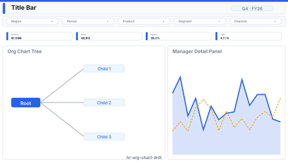

# Org Chart with Span-of-Control

> **Preview:**  · variants: [annotated](../../assets/layout-previews/hr-org-chart-drill-annotated.svg) · [dark](../../assets/layout-previews/hr-org-chart-drill-dark.svg)

- Canvas: `1920×1080` (landscape-16x9)
- Style: `analytical` · Domain: `hr`
- Visuals: 5
- Zones: `title-bar, slicer-row, span-of-control-kpi, org-chart-tree, manager-detail-panel`

## Use when
Org design / span-of-control review with manager-level drill

## Avoid when
Matrix / dotted-line heavy orgs where a tree misrepresents structure

## Recommended themes
`hr-people-analytics`, `microsoft-fluent`, `consulting-authority`

## Chart patterns
`tree-visual`, `kpi-card-with-spark`, `entity-panel`

## Data requirements
- min_rows: 50
- required_measures: `reports_count`
- required_dimensions: `manager_id`, `employee_id`
- date_grain: `month`

## Customization allowed
- **FHD headroom (optional)** — coordinates in `layouts-index.json` zone space; both host zones shrink in height to make room (5 → 7 visuals, within the Analytical budget of 12):
  - Shrink `manager-detail-panel` to `(1120, 304, 784, 480)`; add `span-distribution-histogram` at `(1120, 808, 784, 256)` — how many managers sit outside the target span of control?
  - Shrink `org-chart-tree` to `(16, 304, 1080, 480)`; add `layers-by-function` at `(16, 808, 1080, 256)` — which functions have the deepest management layering?

See `layouts-index.json` for full machine-readable entry including `zones_detail[]`.
