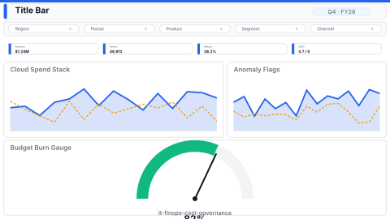

# FinOps Cloud Cost Governance

> **Preview:**  · variants: [annotated](../../assets/layout-previews/it-finops-cost-governance-annotated.svg) · [dark](../../assets/layout-previews/it-finops-cost-governance-dark.svg)

- Canvas: `1920×1080` (landscape-16x9)
- Style: `analytical` · Domain: `technology`
- Visuals: 9
- Zones: `title-bar, slicer-row, kpi-row-4, cloud-spend-stack, anomaly-flags, budget-burn-gauge`

## Use when
Monthly cloud spend review — spend by service/team, anomaly detection, budget burn-down

## Avoid when
Without tagged cost data or a per-team budget allocation

## Recommended themes
`corporate-financial`, `tech-monitoring`, `brand-stripe`, `consulting-authority`

## Chart patterns
`stacked-area`, `anomaly-trend`, `gauge`

## Data requirements
- min_rows: 500
- required_measures: `cost`, `budget`
- required_dimensions: `service`, `team`
- date_grain: `day`

## Customization allowed
- **FHD headroom (optional)** — coordinates in `layouts-index.json` zone space; `budget-burn-gauge` shrinks to `(16, 688, 1008, 376)` to make room (9 → 11 visuals, within the Analytical budget of 12):
  - `unit-cost-trend` at `(1048, 688, 432, 376)` — is cost per unit (transaction/customer) falling while total spend grows?
  - `untagged-spend-by-team` at `(1504, 688, 400, 376)` — which teams carry the most untagged, unallocatable spend?

See `layouts-index.json` for full machine-readable entry including `zones_detail[]`.
