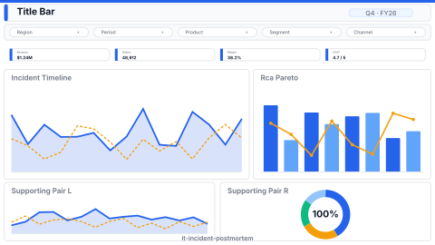

# Incident Postmortem

> **Preview:**  · variants: [annotated](../../assets/layout-previews/it-incident-postmortem-annotated.svg) · [dark](../../assets/layout-previews/it-incident-postmortem-dark.svg)

- Canvas: `1920×1080` (landscape-16x9)
- Style: `analytical` · Domain: `technology`
- Visuals: 8
- Zones: `title-bar, slicer-row, mttr-kpis, incident-timeline, rca-pareto, supporting-pair`

## Use when
Post-incident review — MTTR / MTBF trend, timeline reconstruction, root-cause pareto

## Avoid when
Without structured incident data (severity, root_cause, duration)

## Recommended themes
`tech-monitoring`, `high-contrast-dark`, `brand-ibm-carbon`

## Chart patterns
`kpi-card-with-spark`, `gantt-timeline`, `pareto`

## Data requirements
- min_rows: 20
- required_measures: `mttr`, `incident_count`
- required_dimensions: `severity`, `service`
- date_grain: `day`

## Customization allowed
- **FHD headroom (optional):** split `supporting-pair` (`x=16, y=808, w=1888, h=256`) into three columns — the existing pair becomes `x=16, w=616` and `x=648, w=616` (16 px gap), and the new slot is `x=1280, y=808, w=624, h=256`: *Repeat-incident rate by service* (bar, top 8) — answers "which services keep recurring after a postmortem?", distinct from the MTTR KPIs and the RCA pareto. Visual count 8 → 9 (budget ≤ 12). One slot only.

See `layouts-index.json` for full machine-readable entry including `zones_detail[]`.
