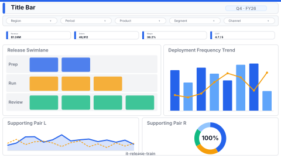

# Release Train (DORA)

> **Preview:**  · variants: [annotated](../../assets/layout-previews/it-release-train-annotated.svg) · [dark](../../assets/layout-previews/it-release-train-dark.svg)

- Canvas: `1920×1080` (landscape-16x9)
- Style: `analytical` · Domain: `technology`
- Visuals: 8
- Zones: `title-bar, slicer-row, dora-kpi-strip, release-swimlane, deployment-frequency-trend, supporting-pair`

## Use when
Engineering effectiveness review — deployment frequency, lead time, change-failure rate, MTTR (DORA)

## Avoid when
Without CI/CD telemetry feeding a consolidated pipeline table

## Recommended themes
`tech-monitoring`, `brand-atlassian`, `brand-google-material`

## Chart patterns
`swimlane`, `kpi-card-with-spark`, `line-yoy`

## Data requirements
- min_rows: 100
- required_measures: `deploy_count`, `lead_time`, `cfr`
- required_dimensions: `service`, `team`
- date_grain: `week`

## Customization allowed
- **FHD headroom (optional):** split `supporting-pair` (`x=16, y=808, w=1888, h=256`) into three columns — the existing pair becomes `x=16, w=616` and `x=648, w=616` (16 px gap), and the new slot is `x=1280, y=808, w=624, h=256`: *Change-failure rate by team* (bar) — answers "which teams ship the riskiest changes?", distinct from the DORA KPI strip and the deployment-frequency trend. Visual count 8 → 9 (budget ≤ 12). One slot only.

See `layouts-index.json` for full machine-readable entry including `zones_detail[]`.
