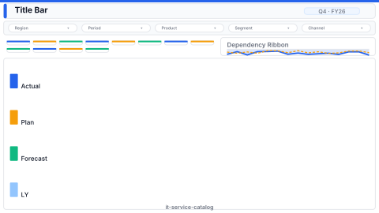

# Service Catalog Health

> **Preview:**  · variants: [annotated](../../assets/layout-previews/it-service-catalog-annotated.svg) · [dark](../../assets/layout-previews/it-service-catalog-dark.svg)

- Canvas: `1920×1080` (landscape-16x9)
- Style: `executive` · Domain: `technology`
- Visuals: 6
- Zones: `title-bar, filter-bar, service-tile-grid, dependency-ribbon, service-health-legend`

## Use when
Portfolio-level service health overview; tile per service with status + dependency ribbon

## Avoid when
Without CMDB or service registry feeding status per service

## Recommended themes
`tech-monitoring`, `microsoft-fluent`, `brand-ibm-carbon`

## Chart patterns
`service-tile`, `dependency-chord`, `legend-panel`

## Data requirements
- min_rows: 10
- required_measures: `health_score`
- required_dimensions: `service`
- date_grain: `day`

## Customization allowed
- **FHD headroom (optional):** none — at budget (Executive pages ≤ 6 visuals; this layout has 6). Use the extra FHD area for larger tiles and whitespace instead.

See `layouts-index.json` for full machine-readable entry including `zones_detail[]`.
