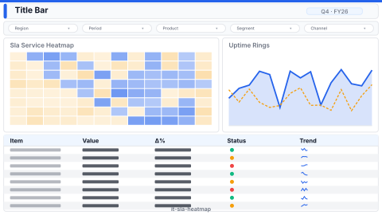

# SLA Heatmap

> **Preview:**  · variants: [annotated](../../assets/layout-previews/it-sla-heatmap-annotated.svg) · [dark](../../assets/layout-previews/it-sla-heatmap-dark.svg)

- Canvas: `1920×1080` (landscape-16x9)
- Style: `operational` · Domain: `technology`
- Visuals: 7
- Zones: `title-bar, slicer-row, sla-service-heatmap, uptime-rings, sla-breach-list`

## Use when
Weekly SLA review — service × time heatmap with breach cells

## Avoid when
When SLA thresholds aren't defined per service

## Recommended themes
`tech-monitoring`, `high-contrast-dark`, `telecom-network`

## Chart patterns
`matrix-heat`, `donut-ring`, `breach-list`

## Data requirements
- min_rows: 200
- required_measures: `uptime_pct`, `sla_target`
- required_dimensions: `service`, `time_bucket`
- date_grain: `day`

## Customization allowed
- **FHD headroom (optional):** narrow `sla-breach-list` (`x=16, y=680, w=1888, h=384`) to `w=1264` and add a slot at `x=1296, y=680, w=608, h=384` (16 px gap): *Breach minutes by root-cause category* (bar) — answers "why are SLAs breached?", distinct from the heatmap (where/when) and the breach list (which tickets). Visual count 7 → 8 (budget ≤ 14). One slot only.

See `layouts-index.json` for full machine-readable entry including `zones_detail[]`.
