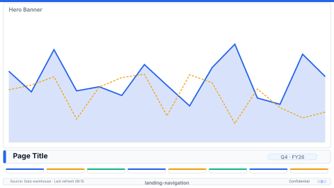

# Layout: Landing / Navigation Hub

> **Preview:** [](../../assets/layout-previews/landing-navigation.svg) · variants: [annotated](../../assets/layout-previews/landing-navigation-annotated.svg) · [dark](../../assets/layout-previews/landing-navigation-dark.svg)

- **id:** `landing-navigation`
- **Canvas:** 1920 × 1080
- **Style personality:** Executive — clean, confident, few words
- **Audience:** All report users; first-time visitors
- **Visual count:** 8 navigation buttons (+ 1 hero banner, 1 title, 1 footer strip)
- **Pairs with themes:** any; this page carries the brand mark and sets first-impression tone

---

## Zone map

```
┌────────────────────────────────────────────────────────────────┐ 0
│                                                                │
│   HERO BANNER (brand logo + tagline, muted illustration)      │ 280
│                                                                │
├────────────────────────────────────────────────────────────────┤
│   "Report name" (32pt Semibold)                               │ 96
│   Subtitle: audience + refresh cadence (14pt)                 │
├────────────────────────────────────────────────────────────────┤
│                                                                │
│   ┌──────┐ ┌──────┐ ┌──────┐ ┌──────┐                         │
│   │ NAV1 │ │ NAV2 │ │ NAV3 │ │ NAV4 │                         │ 256
│   └──────┘ └──────┘ └──────┘ └──────┘                         │
│   ┌──────┐ ┌──────┐ ┌──────┐ ┌──────┐                         │
│   │ NAV5 │ │ NAV6 │ │ NAV7 │ │ NAV8 │                         │ 256
│   └──────┘ └──────┘ └──────┘ └──────┘                         │
│                                                                │
├────────────────────────────────────────────────────────────────┤ 1008
│   Footer links: Help · Data sources · Contact                 │
└────────────────────────────────────────────────────────────────┘ 1080
```

## Slot specifications

| Slot | x | y | w | h | Visual type | Notes |
|---|---|---|---|---|---|---|
| Hero banner | 0 | 0 | 1920 | 280 | image / shape | Full-bleed; low-contrast; brand accent only |
| Page title | 32 | 296 | 1384 | 64 | textbox | 32pt Semibold |
| Subtitle | 32 | 368 | 1384 | 24 | textbox | Muted; 14pt |
| Nav button 1–4 | 32 / 504 / 976 / 1448 | 424 | 440 | 256 | button | Icon 48px + label 16pt Semibold + caption |
| Nav button 5–8 | 32 / 504 / 976 / 1448 | 712 | 440 | 256 | button | Same pattern |
| Footer links | 32 | 1008 | 1856 | 40 | textbox | Right-align secondary links |

Gutters: 32px between buttons (columns and rows); 8px title→subtitle; edge margin 32px; all multiples of 8.

## Navigation

This IS the navigation. Each button uses a page-navigation action (Format pane → Action → Type: Page navigation → Destination: target page). Add visible hover state via Format pane → Shape → Fill → On hover.

## Theme + iconography guidance

- **Palette:** calm; restrict to 1 brand accent + neutrals
- **Logo:** **primary brand mark lives here** — hero-banner left, 80–120px wide, paired with tagline. This is the canonical page for logo treatment; downstream pages reuse the small top-bar variant (≤ 28px).
- **Icons:** one per nav button; use `icons/tabler-outline/` set for consistency
- **Fonts:** Segoe UI Semibold for title; Segoe UI for everything else

## When NOT to use this layout

- ❌ Single-page report (no navigation needed)
- ❌ Internal tool with no onboarding need (use `exec-overview-16x9` directly)
- ❌ You want to show data on page 1 (landing page is branding/nav only — put the data on a proper overview page)

## Customization allowed

- **FHD headroom (optional):** none — at budget (a navigation hub carries no data visuals by design; use the extra FHD area for larger buttons and whitespace).
