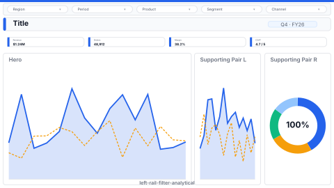

# Layout: Left-Rail Filter Analytical

> **Preview:** [](../../assets/layout-previews/left-rail-filter-analytical.svg) · variants: [annotated](../../assets/layout-previews/left-rail-filter-analytical-annotated.svg) · [dark](../../assets/layout-previews/left-rail-filter-analytical-dark.svg)

- **id:** `left-rail-filter-analytical`
- **Canvas:** 1920 × 1080
- **Style personality:** Analytical
- **Audience:** Analysts, planners, ops managers who filter heavily before reading
- **Visual count:** 9 (excluding slicers in rail) — reflow-enhanced (was 7)
- **Pairs with themes:** neutral analytical; subtle accent on hero only
- **Observed in:** `references-pbip/MANUFACTURING DEMO V3.Report/` — "BC Tổng quan NVL"

---

## Zone map

```
┌─────────┬──────────────────────────────────────────────────────┐ 0
│ FILTER  │  Title + subtitle                                   │ 80
│  RAIL   ├──────────────────────────────────────────────────────┤
│ (328w)  │  KPI row (4 multi-row cards)                        │ 144
│         ├──────────────────────────────────────────────────────┤
│ Slicer1 │                                                      │
│ Slicer2 │           Hero combo chart (wide)                    │ 320
│ Slicer3 │                                                      │
│ Slicer4 │                                                      │
│ Slicer5 ├──────────────────────────────────────────────────────┤
│ Slicer6 │  Supporting chart 1  │  Supporting chart 2           │ 408
│         │                      │                               │
└─────────┴──────────────────────────────────────────────────────┘ 1080
```

---

## Slot specifications

| Slot | x | y | w | h | Visual type | Notes |
|---|---|---|---|---|---|---|
| Filter rail background | 24 | 24 | 328 | 1032 | shape (rect) | Subtle inset panel to separate from body; behind slicers, logo, reset button |
| Slicer 1–6 | 40 | 104, 248, 392, 536, 680, 824 | 296 | 128 | slicer (dropdown/list) | Stack vertically in rail |
| Rail footer: reset-filters button | 40 | 984 | 296 | 56 | actionButton | "Clear filters" |
| Page title | 376 | 24 | 1520 | 48 | textbox | 22pt Semibold |
| Subtitle | 376 | 80 | 1520 | 24 | textbox | 12pt muted |
| KPI 1–4 | 376 / 760 / 1144 / 1528 | 128 | 368 | 144 | cardVisual | 16px gutter between cards |
| Hero combo chart | 376 | 296 | 1520 | 320 | lineStackedColumnComboChart | Trend + bars overlay |
| Supporting 1 | 376 | 640 | 752 | 408 | bar or column | |
| Supporting 2 | 1144 | 640 | 752 | 408 | donutChart, pivotTable, or small-multiple | |

Gutters: 24px between rail and body and between body rows; 16px between KPIs and between the supporting pair. Edge margin 24px; all multiples of 8.

---

## Navigation

Single-page analytical. If part of a multi-page report, rail's top 40px becomes a page-tab strip (actionButtons) and first slicer pushes to y=120 (stack shifts 16px; slicer 6 then ends at y=968, still clear of the reset button at y=984).

---

## Theme + iconography guidance

- **Palette:** neutral; reserve one accent for the hero's line overlay. Rail background 4–6% tint of the accent.
- **Logo:** small company wordmark top-left inside rail at `(40, 40)`, max height 24px — the rail is the page chrome, logo belongs there. Leave title row logo-free.
- **Icons:** one small filter-funnel icon at the top of the rail so users recognize the zone instantly.
- **Fonts:** Segoe UI; rail slicer labels 10pt muted, values 12pt.

---

## When NOT to use this layout

- ❌ Executive audience — rail feels like a control panel, not a briefing
- ❌ Fewer than 3 slicers — rail looks empty
- ❌ Canvas narrower than 1200px — body compresses below legibility
- ❌ Mobile / tooltip contexts

---

## Customization allowed

- Collapse rail to 180px if slicers are compact single-select
- Swap hero to a full-width matrix if analysis is tabular
- Add a 2nd KPI row if more than 4 KPIs (2nd row at y=288, h=96; push hero to y=408, reduce hero h to 208)
- **FHD headroom (optional):** up to two extra slots (visual count 9 → 11, budget ≤ 12). Use on the base layout, not combined with the reflow strip below:
  1. Narrow **Hero combo chart** to `w=1136` and add `Top/bottom contributors` at `x=1528, y=296, w=368, h=320` (16px gap, aligned to the KPI 4 column) — ranked bar answering "which members drive the hero's movement?".
  2. Split the supporting row into three: Supporting 1 → `x=376, w=496`, Supporting 2 → `x=888, w=496`, new `Exception list` at `x=1400, y=640, w=496, h=408` (compact table) — answers "which records breach threshold and need action?".

## Customization NOT allowed

- Moving the rail to the right (breaks reading order)
- Removing the rail while keeping the layout ID (that's a different layout)
- Shrinking rail below 160px (slicer labels wrap unreadably)

---

## Reflow additions (v0.6)

Six slicers are often too many — the 6th slot becomes a **narrative card** that tells the analyst what the current filter combination *means* in plain language, and a **mini-breakdown sparkline strip** above the supporting pair surfaces per-segment trends without requiring a separate drill.

### Integration

Reassign **Slicer 6** (`x=40, y=824, w=296, h=128`) to a narrative card. If 6 slicers are truly required, push the narrative to the body at `x=376, y=296, w=1520, h=32` and shrink the Hero chart by 40px from the top (`y=336, h=280`). Mini-breakdown strip reclaims a 32h band above the supporting pair.

### New slots

| Slot | x | y | w | h | Visual type | Notes |
|---|---|---|---|---|---|---|
| Narrative context card | 40 | 824 | 296 | 128 | cardVisual | Replaces Slicer 6; reads current filter state + dominant measure in sentence form |
| Mini-breakdown strip | 376 | 632 | 1520 | 32 | lineChart × 5 (sparkline-mini) | Per-segment sparks above the supporting pair; supporting charts move to y=680 and reduce h to 368 |

