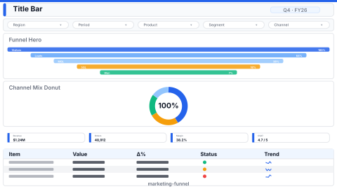

# Layout: Marketing Funnel & Attribution

> **Preview:** [](../../assets/layout-previews/marketing-funnel.svg) · variants: [annotated](../../assets/layout-previews/marketing-funnel-annotated.svg) · [dark](../../assets/layout-previews/marketing-funnel-dark.svg)

- **id:** `marketing-funnel`
- **Canvas:** 1920 × 1080
- **Style personality:** Analytical
- **Audience:** Marketing managers, growth analysts, digital leads
- **Visual count:** 7
- **Pairs with themes:** vibrant analytical; channel colors consistent across page

## Zone map

```
┌────────────────────────────────────────────────────────────────┐ 0
│ Title bar: "Acquisition funnel — {Period}"                    │ 56
├────────────────────────────────────────────────────────────────┤
│ Campaign slicer row (Campaign · Channel · Region · Segment)   │ 48
├────────────────────────────────────────────────────────────────┤
│                                   │                           │
│      FUNNEL HERO                  │   Channel mix donut       │ 416
│   (Impr → Click → Lead →          │   + side legend           │
│    MQL → SQL → Closed Won)        │                           │
├────────────────────────────────────────────────────────────────┤
│ ┌──CVR──┐ ┌──CPA──┐ ┌──ROAS─┐ ┌──MQL→SQL─┐                    │ 128
│ └───────┘ └───────┘ └───────┘ └──────────┘                    │
├────────────────────────────────────────────────────────────────┤
│ Attribution table (channel × touchpoint × revenue)            │ 288
└────────────────────────────────────────────────────────────────┘ 1080
```

## Slot specifications

| Slot | x | y | w | h | Visual type | Notes |
|---|---|---|---|---|---|---|
| Title bar | 24 | 24 | 1872 | 56 | textbox | Include period in title |
| Campaign slicer | 24 | 96 | 1872 | 48 | slicer × 4 | Campaign, Channel, Region, Segment |
| Funnel hero | 24 | 168 | 1200 | 416 | funnel / bar | Show count + CVR% between stages |
| Channel mix donut | 1240 | 168 | 656 | 416 | donut | Center label = dominant channel |
| KPI: CVR | 24 | 608 | 456 | 128 | card | Conversion rate |
| KPI: CPA | 496 | 608 | 456 | 128 | card | Cost per acquisition |
| KPI: ROAS | 968 | 608 | 456 | 128 | card | Return on ad spend |
| KPI: MQL→SQL | 1440 | 608 | 456 | 128 | card | Mid-funnel velocity |
| Attribution table | 24 | 760 | 1872 | 288 | pivotTable | Channel × touchpoint × revenue, data bars on revenue |

Gutters: 16px inside a group (title→slicer, funnel↔donut, between KPI cards); 24px between groups (slicer→funnel, funnel→KPIs, KPIs→table). Edge margin 24px.

## Theme + iconography guidance

- **Channel palette**: stable mapping (Paid Search = blue, Organic = green, Social = orange, etc.) — apply in theme `dataColors` so donut/funnel/table agree
- **Logo:** company wordmark top-left of title bar at `(24, 38)` (vertically centred in the 56px bar), max height 28px. Do NOT use channel partner logos inside the donut — show their name in the legend only (avoid trademark misuse).
- **Icons on KPIs**: funnel, dollar, megaphone, arrow-right
- Use data bars (not heat background) on attribution revenue column

## When NOT to use this layout

- ❌ Brand-awareness only campaigns (no conversion funnel yet) — use trend + reach card
- ❌ Single-channel deep dive — use `sales-performance` with channel filter instead
- ❌ Creative asset library — not a reporting page (use SharePoint)

## Customization allowed

- **FHD headroom (optional):** narrow **Attribution table** to `w=1232` (`x=24, y=760, h=288` unchanged) and add `Spend vs revenue by channel` at `x=1272, y=760, w=624, h=288` (16px gap) — scatter/bubble that answers "which channels deserve more budget?", distinct from the CPA/ROAS cards and the attribution rows. Visual count 7 → 8 (budget ≤ 12). One slot only.
