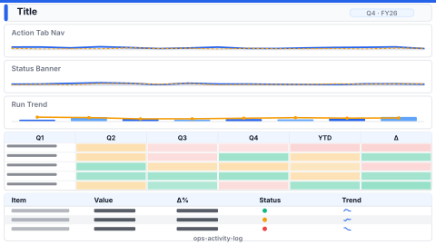

# Layout: Ops Activity Log

> **Preview:** [](../../assets/layout-previews/ops-activity-log.svg) · variants: [annotated](../../assets/layout-previews/ops-activity-log-annotated.svg) · [dark](../../assets/layout-previews/ops-activity-log-dark.svg)

- **id:** `ops-activity-log`
- **Canvas:** 1920 × 1080
- **Style personality:** Operational — audit / troubleshooting
- **Audience:** Ops engineers, data platform owners, on-call responders
- **Visual count:** 9 (tab strip + status banner + trend + status matrix + log table + detail tooltip trigger) — reflow-enhanced (was 6)
- **Pairs with themes:** neutral / light with a single alert accent; dark mode friendly
- **Observed in:** `references-pbip/Monitoring_ADF_DB_v2.Report/` — "PipelineRuns"

---

## Zone map

```
┌────────────────────────────────────────────────────────────────┐ 0
│ Title bar                                                     │ 64
├────────────────────────────────────────────────────────────────┤
│ [Tab1] [Tab2] [Tab3] [Tab4]   (actionButton nav)              │ 128
├────────────────────────────────────────────────────────────────┤
│ STATUS BANNER — cardVisual (Success / Failed / Running)       │ 240
├──────────────────────────────────┬─────────────────────────────┤
│                                  │                             │
│  Run trend (stacked area)        │  Pipeline × status matrix  │ 616
│                                  │                             │
├──────────────────────────────────┴─────────────────────────────┤
│                                                                │
│  Activity log (sortable table) — newest first                 │ 1048
│                                                                │
└────────────────────────────────────────────────────────────────┘ 1080
```

---

## Slot specifications

| Slot | x | y | w | h | Visual type | Notes |
|---|---|---|---|---|---|---|
| Title | 32 | 16 | 1456 | 48 | textbox | 20pt Semibold |
| Refresh timestamp | 1504 | 24 | 384 | 32 | textbox | "Last refresh {ts}" right-aligned |
| Tab button 1–4 | 32 / 304 / 576 / 848 | 72 | 256 | 56 | actionButton | Shows selected-state variant |
| Status banner | 32 | 144 | 1856 | 96 | cardVisual | 3 cells: success count, failed count, running count |
| Run trend (area) | 32 | 256 | 720 | 360 | stackedAreaChart | Hourly / daily stacked by status |
| Pipeline × status matrix | 768 | 256 | 1120 | 360 | pivotTable | Rows=pipeline, cols=status, cells=count |
| Activity log table | 32 | 632 | 1856 | 416 | tableEx | Columns: ts, pipeline, trigger, status, duration, actor, id |

Margins: 32px left/right/bottom. Gaps: 16px between tabs, between trend and matrix, and between bands. Status banner spans full body width to anchor the page. All slots multiples of 8.

---

## Navigation

Tab-strip IS the navigation — each button bookmarks to a sibling page (`PipelineRuns`, `TriggerRuns`, `DatasetExecutions`, `Alerts`). Use the selected-state button variant so users can see which page they're on.

---

## Theme + iconography guidance

- **Palette:** neutral grey base + one alert accent (red for failed). Success / running tint 4–8% opacity on banner cells.
- **Logo:** omit — this is an internal ops page, logo adds chrome without function. If branding is mandated, place at `(32, 28)` max height 24px, move title to `x=72` and narrow it to `w=1416`.
- **Icons:** status glyphs (check / cross / spinner / pause) on banner cells and in log-table `status` column; must match the ones used in the matrix legend.
- **Fonts:** monospace for the `id` column of the log table so hash/UUID values align.

---

## When NOT to use this layout

- ❌ Audience is exec — too dense, no narrative (use an exec `ops-single-screen` instead)
- ❌ No log-level data available — bottom table becomes filler
- ❌ Less than 3 pipelines — matrix is over-kill, collapse to a simple list

---

## Customization allowed

- Swap trend chart for a Gantt-style run duration view if duration matters more than count
- Collapse banner to 2 cells if only success / failed exists (no "running" state)
- Add an additional filter slicer row below the tab strip (slicer row at `y=136, h=48`; pushes status banner to y=200 and requires shrinking the body bands by 56px)
- **FHD headroom (optional)**: one extra slot, answering "which trigger type fails most?" — shrink **Pipeline × status matrix** to `x=768, y=256, w=800, h=360`, then add **Failures by trigger type** (clustered bar) at `x=1584, y=256, w=304, h=360`. No overlap; stays within the Operational ≤ 14 budget.
## Customization NOT allowed

- Removing the tab strip if the page is part of a navigable log suite (breaks sibling-page wayfinding)
- Dropping the refresh timestamp — ops audiences need dataset freshness visible
- Using more than 1 alert colour (dilutes the failed / red signal)

---

## Reflow additions (v0.6)

The log table takes the full bottom width but responders also need **severity triage** and **top-failing pipelines** without scrolling. Reclaim a 368w right sidebar beside the log for those, plus a dismissible **incident banner** at the top of the body for active P1/P2.

### Integration

Shrink **Activity log table** from `w=1856` to `w=1472`. The sidebar occupies `x=1520–1888`. The incident banner appears only when `alerts > 0` — otherwise the status banner retains its full-width role. When shown, shift the status banner, trend/matrix row and log/sidebar down 48px and reduce their heights (log table and sidebar slots by 48px in total) to stay inside the canvas.

### New slots

| Slot | x | y | w | h | Visual type | Notes |
|---|---|---|---|---|---|---|
| Incident banner | 32 | 136 | 1856 | 40 | shape + textbox + actionButton | Shown only when P1/P2 > 0; "Acknowledge" button right; overlay on the status banner's top edge until the body is pushed down 48px |
| Severity triage card | 1520 | 632 | 368 | 192 | cardVisual | P1 / P2 / P3 counts with trend arrow |
| Top-failing pipelines | 1520 | 840 | 368 | 208 | tableEx (compact) | Top 5 pipelines by failure count (last 24h) |

