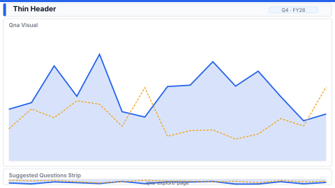

# Layout: Q&A Explore Page

> **Preview:** [](../../assets/layout-previews/qna-explore-page.svg) · variants: [annotated](../../assets/layout-previews/qna-explore-page-annotated.svg) · [dark](../../assets/layout-previews/qna-explore-page-dark.svg)

- **id:** `qna-explore-page`
- **Canvas:** 1920 × 1080
- **Style personality:** Analytical — self-service exploration surface
- **Audience:** Power users, ad-hoc analysts, executives with specific questions
- **Visual count:** 3 (thin header, Q&A visual, suggested-questions strip)
- **Pairs with themes:** neutral; accent reserved for the Q&A result visual
- **Observed in:** `references-pbip/FMCG_Sales Analytics Demo v.2024.01 (Eng).Report/` — "Q&A"

---

## Zone map

```
┌────────────────────────────────────────────────────────────────┐ 0
│ Thin header: page title + "Ask a question"                    │ 72
├────────────────────────────────────────────────────────────────┤
│                                                                │
│                                                                │
│                                                                │
│                    Q&A VISUAL (full canvas)                   │
│                                                                │ 848
│                                                                │
│                                                                │
│                                                                │
├────────────────────────────────────────────────────────────────┤
│ Suggested questions: [chip1] [chip2] [chip3] [chip4]          │ 80
└────────────────────────────────────────────────────────────────┘ 1080
```

---

## Slot specifications

| Slot | x | y | w | h | Visual type | Notes |
|---|---|---|---|---|---|---|
| Thin header | 24 | 24 | 1872 | 72 | shape + textbox | Accent strip; "Ask about {subject area}" right-aligned hint |
| Q&A visual | 24 | 112 | 1872 | 848 | qnaVisual | Primary canvas element |
| Suggested-questions strip | 24 | 976 | 1872 | 80 | row of actionButtons | Each button fires a `Q&A` text via bookmark |

Gutters: 16px between header and Q&A, 16px between Q&A and suggestion strip.

---

## Navigation

- This page is typically linked from a top-nav or landing page. Include a small "← Back" action button inside the header at `(40, 48)` if the page is not the landing.
- Suggested-question buttons navigate via bookmark to the SAME page with a pre-seeded Q&A question — they are not separate pages.

---

## Theme + iconography guidance

- **Palette:** neutral body; the thin header carries the one accent colour and sets context.
- **Logo:** optional — if the page is meant to be "self-service hub" of the report, place logo top-left in the header at `(40, 48)` max height 24px. Otherwise omit.
- **Icons:** one "sparkles" / conversation glyph on the header right, next to the "Ask about…" hint. One icon per suggested-question chip if the sibling pages use icons consistently.
- **Fonts:** header title 16pt Semibold. Suggestion chips 11pt.

---

## When NOT to use this layout

- ❌ Model does not have Q&A synonyms / linguistic schema configured — Q&A results will be low-quality
- ❌ Audience unfamiliar with Q&A — they need a guided dashboard instead (`exec-overview-16x9`)
- ❌ Sensitive / gated measures that should not surface via natural language
- ❌ Mobile canvases — Q&A input field is not optimized for touch

---

## Customization allowed

- Collapse the suggestion strip to extend the Q&A visual down to y=1056 (h=944)
- Add a left-rail of "Featured reports" links (208w, 16 px gap) and shrink Q&A visual to 1648w
- Prepend a "Recently asked" row above the suggestion strip (64h + 16 px gap; pushes Q&A h to 768)
- FHD headroom (optional): none — page is deliberately single-purpose (see NOT allowed); extra slots would contradict the Q&A-is-the-page pattern

## Customization NOT allowed

- Adding other chart visuals to this page (defeats the "Q&A is the page" pattern — put those on a sibling page instead)
- Hiding the Q&A visual behind a bookmark toggle (makes the page look empty on first load)
- Using Q&A as a replacement for a proper drillthrough (Q&A results cannot carry selection context cleanly)
