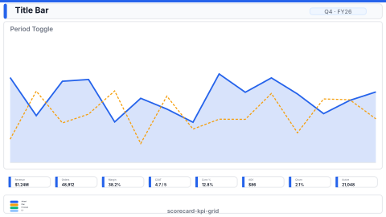

# Layout: Balanced Scorecard / KPI Grid

> **Preview:** [](../../assets/layout-previews/scorecard-kpi-grid.svg) · variants: [annotated](../../assets/layout-previews/scorecard-kpi-grid-annotated.svg) · [dark](../../assets/layout-previews/scorecard-kpi-grid-dark.svg)

- **id:** `scorecard-kpi-grid`
- **Canvas:** 1920 × 1080
- **Style personality:** Executive — signal-dense, low-noise
- **Audience:** Executives, strategy office, OKR owners
- **Visual count:** 12 KPI tiles (+ title, period toggle, legend)
- **Pairs with themes:** muted neutral; semantic green/amber/red only

## Zone map

```
┌────────────────────────────────────────────────────────────────┐ 0
│ Title bar: "Enterprise Scorecard — {Period}"                  │ 48
├────────────────────────────────────────────────────────────────┤
│ Period toggle (MTD / QTD / YTD) right of title, same band     │ 48
├────────────────────────────────────────────────────────────────┤
│ ┌───┐ ┌───┐ ┌───┐ ┌───┐                                       │
│ │K1 │ │K2 │ │K3 │ │K4 │   Perspective 1: Financial           │ 280
│ └───┘ └───┘ └───┘ └───┘                                       │
│ ┌───┐ ┌───┐ ┌───┐ ┌───┐                                       │
│ │K5 │ │K6 │ │K7 │ │K8 │   Perspective 2: Customer            │ 280
│ └───┘ └───┘ └───┘ └───┘                                       │
│ ┌───┐ ┌───┐ ┌───┐ ┌───┐                                       │
│ │K9 │ │K10│ │K11│ │K12│   Perspective 3: Process / Growth    │ 280
│ └───┘ └───┘ └───┘ └───┘                                       │
├────────────────────────────────────────────────────────────────┤
│ Legend strip: ● On track · ● At risk · ● Off track            │ 40
└────────────────────────────────────────────────────────────────┘ 1080
```

## Slot specifications

| Slot | x | y | w | h | Visual type | Notes |
|---|---|---|---|---|---|---|
| Title bar | 32 | 24 | 1392 | 48 | textbox | |
| Period toggle | 1440 | 24 | 448 | 48 | slicer (tile) | MTD/QTD/YTD buttons |
| KPI tile 1–4 | 32/504/976/1448 | 96 | 448 | 280 | card | Row 1 — financial perspective |
| KPI tile 5–8 | 32/504/976/1448 | 400 | 448 | 280 | card | Row 2 — customer perspective |
| KPI tile 9–12 | 32/504/976/1448 | 704 | 448 | 280 | card | Row 3 — process / growth |
| Legend strip | 32 | 1008 | 1856 | 40 | textbox + shape | Traffic-light legend |

Gutters: 16px between tiles in a row, 24px between perspective rows and below the title band.

Each KPI tile contains: metric name (11pt), big value (36pt Semibold), delta vs target (12pt muted), status dot (left-edge 6px strip colored per status), mini sparkline (bottom 30% of tile).

## Theme + iconography guidance

- **Palette:** neutrals + green/amber/red traffic-light triad only — no other accents
- **Logo:** company wordmark top-left of title bar at `(32, 24)`, max height 28px — scorecards are formal exec docs, logo is expected. Period toggle pins to top-right of same bar; do not compete with logo.
- **Icons:** one per perspective (dollar, users, gear); place top-right of each tile
- **Status strip**: 6px left-edge colored bar is the primary signal, not the text

## When NOT to use this layout

- ❌ Need to explain movements — no room for narrative; pair with exec-overview
- ❌ KPIs require different time-grain per tile (scorecard assumes shared period toggle)
- ❌ Fewer than ~8 KPIs — the grid looks sparse; use `exec-overview-16x9` instead

## Customization allowed

- **FHD headroom (optional):** none — at budget. The 12 KPI tiles already exceed the Executive ≤ 6 visual budget by design; the extra FHD area goes into larger tiles (448 × 280), not into more visuals.
