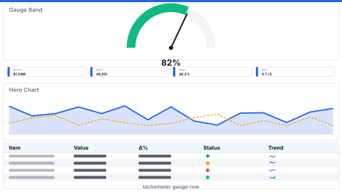

# Layout: Tachometer Gauge Row

> **Preview:** [](../../assets/layout-previews/tachometer-gauge-row.svg) · variants: [annotated](../../assets/layout-previews/tachometer-gauge-row-annotated.svg) · [dark](../../assets/layout-previews/tachometer-gauge-row-dark.svg)

- **id:** `tachometer-gauge-row`
- **Canvas:** 1920 × 1080
- **Style personality:** Operational — Top band of 3–4 tachometer gauges (target arc + needle) + KPI cards + map below
- **Audience:** Ops managers, logistics supervisors monitoring KPI-vs-target status
- **Visual count:** 11 — reflow-enhanced (was 9)
- **Pairs with themes:** neutral body with one accent — pattern designed to read on any corporate palette.
- **Observed in:** `references-pbip/SCM - LOGISTICS DEMO.Report/` — 'LOGISTICS OVERVIEW' (3× Tachometer visuals at y=0, h≈170)

---

## Zone map

```
┌────────────────────────────────────────────────────────────────┐ 0
│ Thin title band                                                │ 48
├──────────────┬───────────────┬───────────────┬─────────────────┤
│              │               │               │                 │
│  ◠ GAUGE 1   │   ◠ GAUGE 2   │   ◠ GAUGE 3   │   ◠ GAUGE 4     │ 240
│              │               │               │                 │
├──────────────┴───────────────┴───────────────┴─────────────────┤
│ KPI card row · 4 small cards                                   │ 104
├────────────────────────────────┬───────────────────────────────┤
│                                │                               │
│    MAP / region bars            │    Trend line (YTD)          │ 400
│                                │                               │
├────────────────────────────────┴───────────────────────────────┤
│ Bottom detail table (top-10 routes / lanes)                    │ 160
└────────────────────────────────────────────────────────────────┘
```

---

## Slot specifications

| Slot | x | y | w | h | Visual type | Notes |
|---|---|---|---|---|---|---|
| Title band | 32 | 24 | 1856 | 48 | textbox + shape | Report title + period slicer |
| Gauge 1–4 | 32 | 96 | 1856 | 240 | customVisual(Tachometer) × 4 | Each ~452w × 240h, min-max-target bound measures |
| KPI card row | 32 | 352 | 1856 | 104 | card × 4–5 | Small cards: raw values supporting gauges |
| Map / region bars | 32 | 472 | 920 | 400 | azureMap or barChart by region | Geography overview |
| Trend line | 968 | 472 | 920 | 400 | lineChart | YTD trend of primary KPI |
| Detail table | 32 | 888 | 1856 | 160 | tableEx or pivotTable | Top routes / facilities by volume |

Gutters: 24px below the title band; 16px between the remaining primary zones; 8px inside KPI card rows.

---

## Navigation

- Reachable from the report's top-nav chiclet strip or landing page. Include a small 'Home' actionButton in the header when not the landing page.
- Cross-links out to related drillthrough / detail pages should be surfaced via card-level actions, not a separate nav rail.

---

## Theme + iconography guidance

- **Palette:** Gauge arcs: red→amber→green for below-target / on-target / above-target. Rest neutral.
- **Logo:** Title band top-left at (32, 32) max height 24px.
- **Icons:** One glyph above each gauge (truck, box, plane, ship) — 20px max.
- **Fonts:** Gauge centre value 22pt, label 10pt. KPI card value 16pt.

---

## When NOT to use this layout

- ❌ KPI has no clear target (gauges are meaningless without one)
- ❌ More than 5 primary KPIs (gauge band becomes crowded — use `scorecard-kpi-grid`)
- ❌ Audience wants trend over status — use `sales-performance` or trend-oriented layout

---

## Customization allowed

- Swap the map for a column chart by lane / region
- Reduce to 3 gauges if fewer KPIs — widen each to ~608w
- **FHD headroom (optional):** add one *Off-target breach list* at `x=1272, y=888, w=616, h=160` (tableEx: gauges currently outside target, top 5 by gap, with owner). It answers a distinct question — who must act now — which the gauges and the route table do not. Shrink **Detail table** from `w=1856` to `w=1224` (`x=32`, ending at 1256, 16px gutter). Brings the page to 12 visuals (operational budget ≤ 14); skip it if the reflow panel/ticker below are used and the page feels crowded.

## Customization NOT allowed

- Using tachometer visual without sufficient color-blind / non-visual annotation (add a text delta under each)
- Stacking two gauge rows — defeats the 'quick glance' purpose

---

## Reflow additions (v0.6)

Gauges show *status now* but not *trajectory*. A **target/threshold legend panel** on the right clarifies what each band means (red/amber/green thresholds), and a **period-comparison ticker** in the title band shows whether today is better/worse than yesterday for each gauge.

### Integration

Shrink the gauge row from `w=1856` to `w=1472` (each of 4 gauges from ~452w to ~356w — still readable). Legend panel at `x=1528, y=96, w=360, h=240`. Period ticker at `x=1184, y=24, w=704, h=48` inside the title band.

### New slots

| Slot | x | y | w | h | Visual type | Notes |
|---|---|---|---|---|---|---|
| Period-comparison ticker | 1184 | 24 | 704 | 48 | cardVisual | Overlay on title band. 4 mini-cards: ΔvYesterday per gauge; directional arrow |
| Threshold legend panel | 1528 | 96 | 360 | 240 | tableEx (compact) + shape | Overlay on the right of the gauge row (gauge row shrinks to w=1472). Red / Amber / Green threshold bands with numeric bounds; non-interactive |

