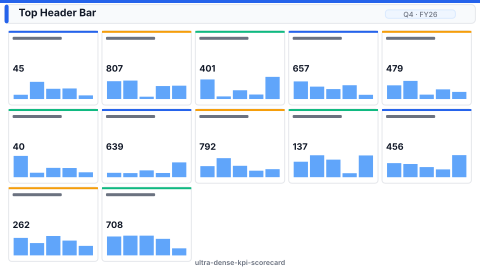

# Layout: Ultra-Dense KPI Scorecard

> **Preview:** [](../../assets/layout-previews/ultra-dense-kpi-scorecard.svg) · variants: [annotated](../../assets/layout-previews/ultra-dense-kpi-scorecard-annotated.svg) · [dark](../../assets/layout-previews/ultra-dense-kpi-scorecard-dark.svg)

- **id:** `ultra-dense-kpi-scorecard`
- **Canvas:** 1920 × 1080
- **Style personality:** Analytical — 4–6 labeled category blocks, each packed with 10–20 KPI cards / shapes / mini-charts
- **Audience:** Supply-chain / ops leaders reviewing 60+ KPIs in one session
- **Visual count:** 60
- **Pairs with themes:** neutral body with one accent — pattern designed to read on any corporate palette.
- **Observed in:** `references-pbip/Supply Chain Analytics.Report/` — 'KPI' (84 visuals), 'OVERALL' (60 visuals); `BTM-MANUFACTURING & SUPPLY CHAIN REPORT.Report/` — 'Purchasing_Overview' (51 visuals)

---

## Zone map

```
┌────────────────────────────────────────────────────────────────┐ 0
│ Thin title + period slicer                                     │ 48
├───────────────────┬───────────────────┬───────────────────┬────┤
│ COST              │ INVENTORY         │ SERVICE           │PROC│
│ ┌─┐┌─┐┌─┐┌─┐┌─┐   │ ┌─┐┌─┐┌─┐┌─┐┌─┐   │ ┌─┐┌─┐┌─┐┌─┐┌─┐   │┌─┐ │
│ └─┘└─┘└─┘└─┘└─┘   │ └─┘└─┘└─┘└─┘└─┘   │ └─┘└─┘└─┘└─┘└─┘   │└─┘ │ 472
│ ┌─┐┌─┐┌─┐┌─┐┌─┐   │ ┌─┐┌─┐┌─┐┌─┐┌─┐   │ ┌─┐┌─┐┌─┐┌─┐┌─┐   │┌─┐ │
│ └─┘└─┘└─┘└─┘└─┘   │ └─┘└─┘└─┘└─┘└─┘   │ └─┘└─┘└─┘└─┘└─┘   │└─┘ │
├───────────────────┼───────────────────┼───────────────────┼────┤
│ (row 2 categories: Demand / Quality / Supplier / Logistics)    │ 472
└────────────────────────────────────────────────────────────────┘
```

---

## Slot specifications

| Slot | x | y | w | h | Visual type | Notes |
|---|---|---|---|---|---|---|
| Title band | 24 | 24 | 1872 | 48 | textbox + slicer(Period) | Title + period |
| Category block × 8 | 24 | 96 | 1872 | 960 | 4×2 grid of category blocks | Each block = label header + 8-12 small KPI card / shape visuals. Typical block size ~456w × 472h (x=24/496/968/1440; y=96/584) |

Gutters: 16px between category blocks; 24px below the title band; 8px inside KPI card rows.

---

## Navigation

- Reachable from the report's top-nav chiclet strip or landing page. Include a small 'Home' actionButton in the header when not the landing page.
- Cross-links out to related drillthrough / detail pages should be surfaced via card-level actions, not a separate nav rail.

---

## Theme + iconography guidance

- **Palette:** Neutral background; each block header uses a faint background tint. KPI traffic-light (green/amber/red) indicators reserved for threshold breaches.
- **Logo:** Title band top-left at (24, 32) max height 20px.
- **Icons:** Category glyph next to each block header (max 16px).
- **Fonts:** Title 14pt, block header 10pt Bold, card value 12pt, label 7pt. Micro-type is intentional — audience is domain-expert.

---

## When NOT to use this layout

- ❌ Audience is exec / casual — information overload. Use `scorecard-kpi-grid` (12 KPIs) instead
- ❌ Any KPI is business-critical on its own — promote it to its own page with context
- ❌ Mobile or small display (< 24" monitor) — layout becomes unreadable

---

## Customization allowed

- Change block layout to 3×3 if category count is 9
- Colour block headers by domain (Finance / Ops / Customer)
- Link each KPI card to a drillthrough for that metric
- **FHD headroom (optional):** none — at budget. The page is a 60-visual card/shape page by design, far beyond any visual budget; the extra FHD area makes each block larger (~456 × 472) so the micro-type stays legible.

## Customization NOT allowed

- Adding chart visuals — this is a card/shape page by design. Charts go on sibling pages
- Reducing visual count below ~40 — use `scorecard-kpi-grid` instead
- Removing category labels — the layout depends on block structure for legibility
