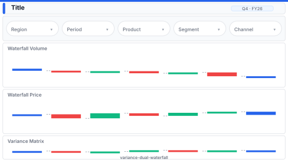

# Layout: Variance Dual Waterfall

> **Preview:** [](../../assets/layout-previews/variance-dual-waterfall.svg) · variants: [annotated](../../assets/layout-previews/variance-dual-waterfall-annotated.svg) · [dark](../../assets/layout-previews/variance-dual-waterfall-dark.svg)

- **id:** `variance-dual-waterfall`
- **Canvas:** 1920 × 1080
- **Style personality:** Analytical — side-by-side decomposition
- **Audience:** Finance controllers, FP&A, business review
- **Visual count:** 7 (2 waterfalls + 2 slicers + 1 matrix) — reflow-enhanced (was 5)
- **Pairs with themes:** neutral with 2 semantic colours (favourable/unfavourable)
- **Observed in:** `references-pbip/Financial Dashboard Demo (FMCG) (Eng ver).Report/` — "GM Variance Analysis YTD by Product"

---

## Zone map

```
┌────────────────────────────────────────────────────────────────┐ 0
│ Title: "GM variance — YTD {Period}"                           │ 48
├────────────────────────────────────────────────────────────────┤
│ Slicer: Period      Slicer: Business unit                     │ 56
├──────────────────────────────┬─────────────────────────────────┤
│                              │                                 │
│   Waterfall A (Volume)       │   Waterfall B (Price / Mix)    │ 432
│                              │                                 │
├──────────────────────────────┴─────────────────────────────────┤
│                                                                │
│   Variance matrix (full width, sortable)                      │ 432
│                                                                │
└────────────────────────────────────────────────────────────────┘ 1080
```

---

## Slot specifications

| Slot | x | y | w | h | Visual type | Notes |
|---|---|---|---|---|---|---|
| Title | 24 | 24 | 1872 | 48 | textbox | 22pt Semibold |
| Slicer: Period | 24 | 88 | 448 | 56 | slicer (tile) | MTD / QTD / YTD |
| Slicer: Segment | 488 | 88 | 448 | 56 | slicer (dropdown) | |
| Waterfall A | 24 | 168 | 928 | 432 | waterfallChart | Volume variance vs plan |
| Waterfall B | 968 | 168 | 928 | 432 | waterfallChart | Price / mix variance vs plan |
| Variance matrix | 24 | 624 | 1872 | 432 | pivotTable | Rows=product, cols=components, total rightmost |

Gutters: 16px between slicers and between waterfalls, 24px between title / slicer row / waterfall row / matrix. Legend pinned inside each waterfall at top-right.

---

## Navigation

Single-page. If launched from exec page, include "← Back" actionButton at `(24, 36)` and shift title to x=80.

---

## Theme + iconography guidance

- **Palette:** 1 favourable colour (typically green / positive accent), 1 unfavourable (red / warning). Neutral grey for "subtotal" bars. NO other hues.
- **Logo:** Optional — omit unless the deck demands branding. If included, place at `(24, 36)`, max height 24px, and shift title to x=80.
- **Icons:** none inside waterfalls (colour is the signal); matrix can use tiny triangle up/down glyphs in variance columns.
- **Fonts:** waterfall category labels 10pt rotated 0° (keep horizontal) — if categories overflow, reduce to 8 per waterfall and move rest to matrix.

---

## When NOT to use this layout

- ❌ Only one variance dimension to decompose — use `finance-pnl-waterfall` instead
- ❌ Audience needs narrative — waterfalls demand context the layout doesn't provide; pair with a text commentary page
- ❌ More than ~10 bars per waterfall — cluttered, switch to a ranked-bar + matrix layout
- ❌ No matrix backing data available — the layout's third row becomes filler

---

## Customization allowed

- Replace matrix with a dual horizontal-bar ranking (top/bottom contributors)
- Stack waterfalls vertically if a deeper decomposition is needed (each 1872w × 280h at y=168 / 472; matrix moves to y=776, h=280)
- Swap slicer pair for a single report-level date range
- FHD headroom (optional): two extra KPI cards in the free right end of the slicer row — "Net Δ % vs plan" at (1416, 88, 224, 56) (relative size of the miss) and "% lines unfavourable" at (1656, 88, 240, 56) (breadth of the miss across product lines)

## Customization NOT allowed

- Using 3 waterfalls in the same row (each compresses below readable bar width)
- Removing the matrix if waterfalls reference items shown only there (breaks audit trail)

---

## Reflow additions (v0.6)

Dual waterfalls explain *what* moved but not *how much net*. Add a **Net Δ KPI card** in the slicer row as the page's anchor number, plus a **Top-drivers insight panel** beside the matrix for the 3 largest bar contributors in prose form.

### Integration

Shrink **Variance matrix** from `w=1872` to `w=1456` (loses the rightmost total column — acceptable, the total is still carried by the Net Δ card). Insight panel sits at `x=1496–1896`.

### New slots

| Slot | x | y | w | h | Visual type | Notes |
|---|---|---|---|---|---|---|
| Net variance KPI | 952 | 88 | 448 | 56 | card | Total Δ vs plan with directional arrow; 20pt value |
| Top-drivers insight | 1496 | 624 | 400 | 432 | cardVisual + textbox | Top-3 drivers: name + Δ + 1-line narrative each |

